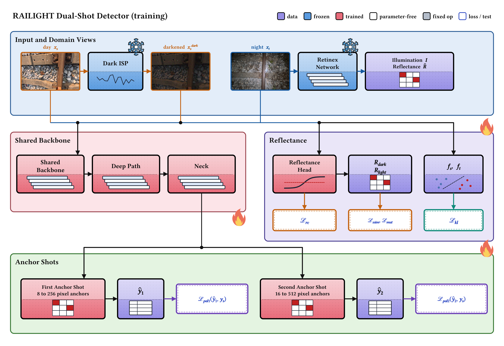
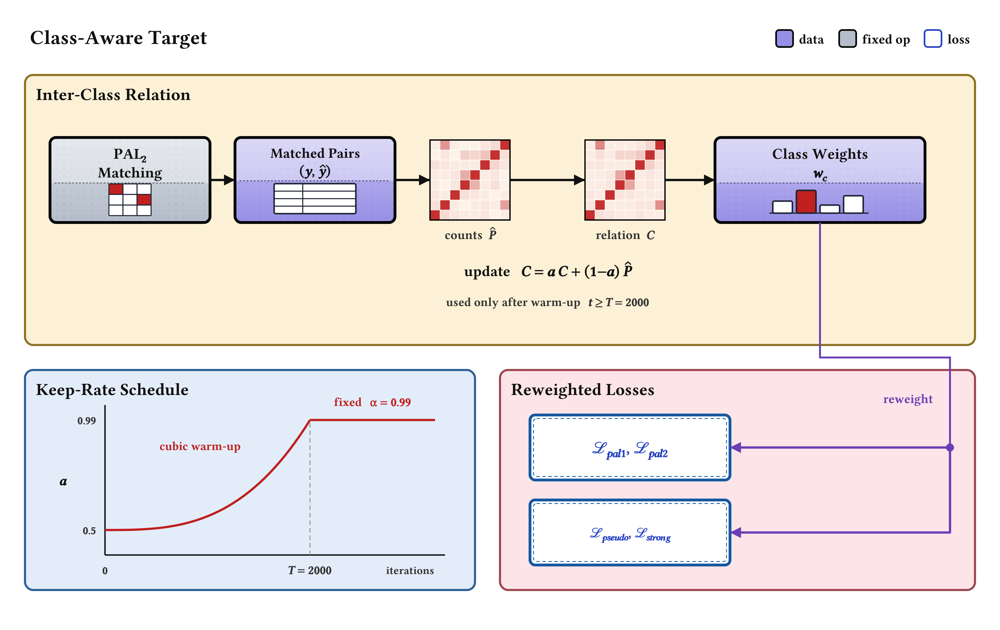
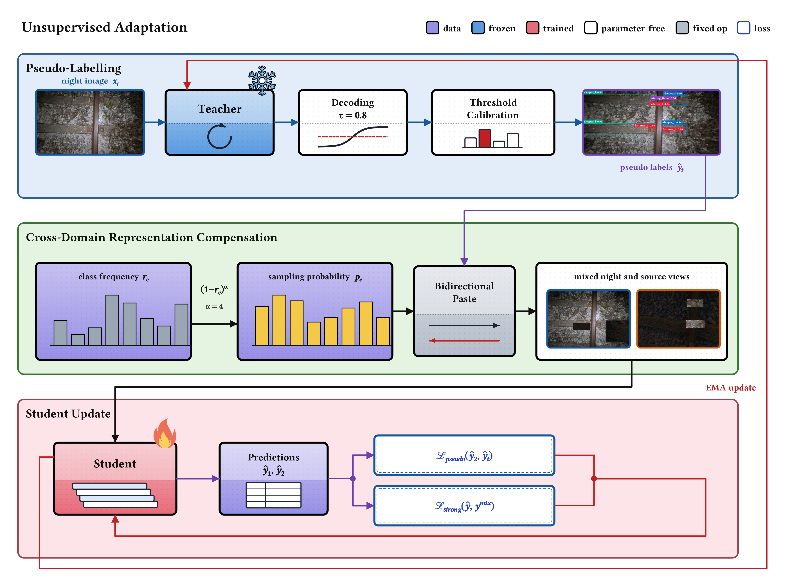
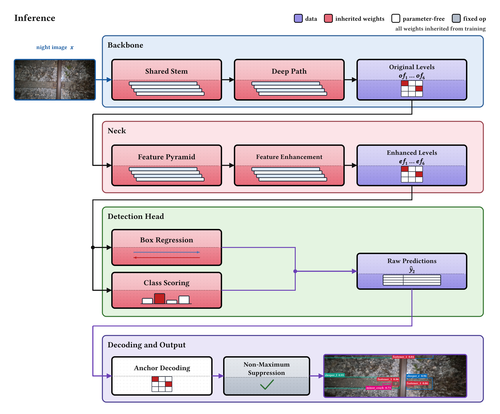

# RAILIGHT

## Overview

RAILIGHT detects railway defects at night while training only on labelled daytime images, so no night annotation is needed. It pairs a DSFD dual shot detector with a frozen Retinex branch and aligns the illumination invariant reflectance across a day view, a synthetic dark view and real night frames.



| Figure | What it shows |
|---|---|
|  | Class aware target, matched pairs drive the per class weights and the keep rate |
|  | Unsupervised adaptation, EMA teacher, calibrated thresholds and cross domain mixing |
|  | Inference, only the backbone, deep path, neck and head stay in the graph |

## Highlights

- Three views per step, a labelled day image, the same image through a 10 step inverse ISP, and an unlabelled real night frame.
- Class aware teacher with an EMA inter class relation matrix and a cubic keep rate schedule.
- Per class confidence calibration and bidirectional cross domain instance mixing for the rare defect classes.
- One YAML config per experiment, one Python entry point, no code edit per run.
- Per class AP@50 reported as an unweighted mean, so a frequent class cannot carry the score.

## Installation

Python 3.10, PyTorch built against the local CUDA driver, numpy below 2.

```bash
conda create -n railight python=3.10 -y
conda activate railight
pip install torch torchvision
pip install -r requirements.txt
```

Data, outputs, logs and checkpoints live outside the repository. Set them in a `.env` file placed in this folder or in the parent workspace folder, see `.env.example`.

```dotenv
STORAGE_ROOT=/absolute/path/to/storage
RAILIGHT_STORAGE=${STORAGE_ROOT}/outputs/railight
RAILIGHT_DATA=${STORAGE_ROOT}/data
WANDB_API_KEY=
```

## Dataset Preparation

Start from a YOLO format dataset with one folder per domain and per split.

```
${RAILIGHT_DATA}/data_exp2/railight/8/
├── source/
│   ├── train/{images,labels}/
│   ├── val/{images,labels}/
│   └── test/{images,labels}/
└── target/
    ├── train/{images,labels}/
    ├── val/{images,labels}/
    └── test/{images,labels}/
```

Convert both domains to the RAILIGHT list format, one line per image holding pixel boxes `x y w h cls`.

```bash
bash scripts/convert_dataset.sh
```

This writes `${RAILIGHT_DATA}/data_exp2/railight/8/dataset/{source,target}_{train,val,test}.txt`. Edit the paths and `MAX_CLASS` at the top of the script for the 4 class setting. Night video is cut into frames with `bash scripts/cut_frames.sh`.

Two pretrained files go under `${RAILIGHT_STORAGE}/weights`, `vgg16_reducedfc.pth` for the backbone and `decomp.pth` for the frozen Retinex DecomNet.

The 8 class label set is `fastener_1`, `critical_crack`, `fastener_2`, `sleeper_l`, `sleeper_r`, `missing_items`, `broken_sleeper`, `minor_crack`. The 4 class set keeps `broken_sleeper`, `minor_crack`, `missing_items` and `critical_crack`.

## Training

Every command goes through `main.py`. Run `python main.py --help` for the full command list and `python main.py <command> --help` for the flags of one command.

| Task | Command |
|---|---|
| RAILIGHT, single or multi GPU | `bash scripts/train.sh` |
| Submit to Slurm | `sbatch scripts/srun.sh` |

The config path and the GPU list are assigned at the top of each script, so edit the script rather than passing environment variables. `scripts/train.sh` reads `gpu_ids` from the config and launches `torchrun` with a matching `nproc_per_node`. A direct call looks like this.

```bash
python main.py train \
    --config configs/train/railight/vgg16/exp4.uda.batch8.weak_strong_augmentation.cat.cra_cdrc_bidirection_mixing.adam.v2.yaml
```

Configs are grouped as `configs/train/<architecture>/<backbone>/<experiment>.<variant>.yaml`. The keys that decide an experiment:

| Key | Meaning |
|---|---|
| `architecture` and `backbone` | `railight` or `dsfd`, plus the backbone name |
| `gpu_ids` | GPUs to use, for example `0` or `0,1` |
| `kl_loss_weight` | strength of the source and target reflectance alignment |
| `target_loss_weight` | unsupervised Retinex loss on the night frames |
| `is_use_supervised_target_loss` | also train on target labels, which leaves the unsupervised setting |
| `cat_enabled`, `cat_warmup_iters`, `cat_max_weight` | class aware teacher and the cap on its weights |
| `pseudo_weight`, `pseudo_start_iters` | mean teacher pseudo label loss and when it starts |
| `focal_enabled`, `focal_class_weights` | focal loss for the class imbalance |
| `box_loss` | `smooth_l1`, `ciou` or `wiou` |
| `val_every_epochs` | validation frequency, which also sets the early stop clock |
| `best_metric` | checkpoint selection metric, `target_map` uses target validation labels |

Outputs land under the storage root, never in the repository.

| Output | Path under `${RAILIGHT_STORAGE}` |
|---|---|
| Checkpoints | `weights/<arch>/<backbone>/<num_exp>/{best_model.pth,last_model.pth}` |
| Charts | `charts/<mode>/<arch>/<backbone>/<num_exp>/` |
| Per epoch records | `records/` |
| Run logs | `logs/` |

## Evaluation / Inference

A test config mirrors the train config it scores. `source_test_files` and `target_test_files` take RAILIGHT list files, the source split is scored through the dark ISP when `align_source_view: dark` and the target split is scored as captured.

| Task | Command |
|---|---|
| RAILIGHT evaluation | `bash scripts/test.sh` |
| Grad-CAM pairs | `bash scripts/visualize.sh` |

Both scripts assign the config path at the top, so edit the script to point at another experiment.

Each evaluation writes `metrics.json` next to its charts. The number to read is `target.macro_map50_isolated`, the unweighted mean of the per class AP@50 on the night test split. The sibling `macro_map50` pools precision over the ground truth and is not comparable with published mAP.

```bash
python main.py test \
    --config configs/test/railight/vgg16/exp4.uda.batch8.weak_strong_augmentation.cat.cra_cdrc_bidirection_mixing.adam.v2.yaml
```

## Results

mAP@50 on the night test split, no night label used during training. Baselines are source only models scored with the same evaluator.

| Setting | Night test images | Best baseline | RAILIGHT |
|---|---|---|---|
| 8 classes | 2193 | 58.14, YOLO26n | **74.83** |
| 4 classes | 1776 | 32.09, YOLO26x | **41.64** |

The baseline numbers were measured with the shared evaluator. Neither the YOLO code nor the table generators are part of this repository.

Operating point on the 8 class split, read from the confusion matrix at a fixed confidence.

| Metric | RAILIGHT |
|---|---|
| Accuracy | 75.44 |
| Precision | 87.57 |
| Recall | 84.49 |
| F1 | 86.00 |

The 4 class setting is the harder one. RAILIGHT leads on mAP@50 and is second on recall, while YOLO26s leads accuracy, precision and F1. mAP integrates over every confidence level, the other four are read at one fixed threshold.

## Acknowledgements / License

```bibtex
@inproceedings{du2024dainet,
  title     = {Boosting Object Detection with Zero-Shot Day-Night Domain Adaptation},
  author    = {Zhipeng Du and Miaojing Shi and Jiankang Deng},
  booktitle = {IEEE Conference on Computer Vision and Pattern Recognition (CVPR)},
  year      = {2024}
}

@inproceedings{kennerley2024cat,
  title     = {CAT: Exploiting Inter-Class Dynamics for Domain Adaptive Object Detection},
  author    = {Mikhail Kennerley and Jian-Gang Wang and Bharadwaj Veeravalli and Robby T. Tan},
  booktitle = {IEEE Conference on Computer Vision and Pattern Recognition (CVPR)},
  year      = {2024}
}

@inproceedings{li2019dsfd,
  title     = {DSFD: Dual Shot Face Detector},
  author    = {Jian Li and Yabiao Wang and Changan Wang and Ying Tai and Jianjun Qian and Jian Yang and Chengjie Wang and Jilin Li and Feiyue Huang},
  booktitle = {IEEE Conference on Computer Vision and Pattern Recognition (CVPR)},
  year      = {2019}
}

@inproceedings{wei2018retinexnet,
  title     = {Deep Retinex Decomposition for Low-Light Enhancement},
  author    = {Chen Wei and Wenjing Wang and Wenhan Yang and Jiaying Liu},
  booktitle = {British Machine Vision Conference (BMVC)},
  year      = {2018}
}

@inproceedings{li2020modeladaptation,
  title     = {Model Adaptation: Unsupervised Domain Adaptation without Source Data},
  author    = {Rui Li and Qianfen Jiao and Wenming Cao and Hau-San Wong and Si Wu},
  booktitle = {IEEE Conference on Computer Vision and Pattern Recognition (CVPR)},
  year      = {2020}
}

@inproceedings{simonyan2015vgg,
  title     = {Very Deep Convolutional Networks for Large-Scale Image Recognition},
  author    = {Karen Simonyan and Andrew Zisserman},
  booktitle = {International Conference on Learning Representations (ICLR)},
  year      = {2015}
}

@misc{ultralytics,
  title        = {Ultralytics YOLO},
  author       = {Glenn Jocher and Jing Qiu and Ayush Chaurasia},
  year         = {2024},
  howpublished = {\url{https://github.com/ultralytics/ultralytics}}
}
```
